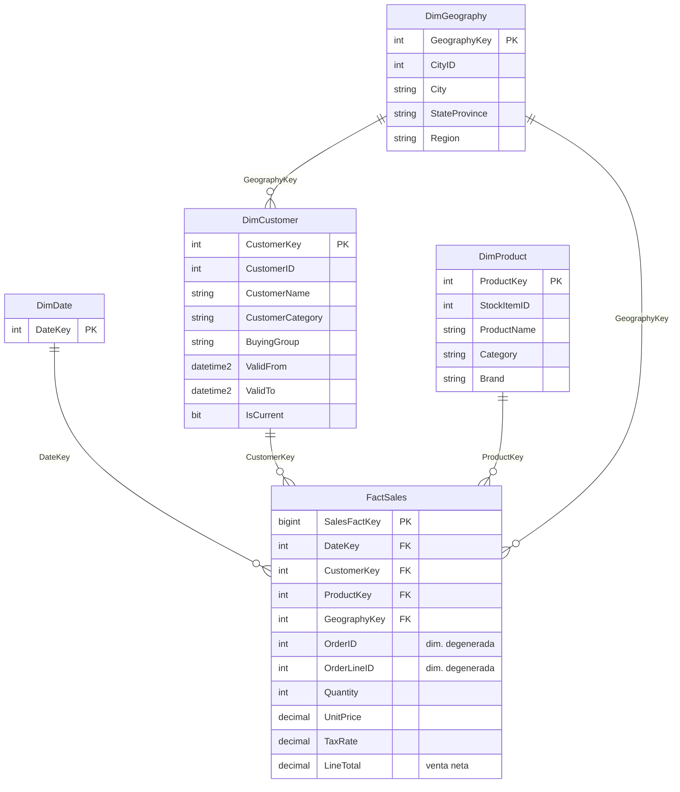

# Fase 4 — Data Warehouse (modelo dimensional)

## 1. Diagrama dimensional (editable)

El texto Mermaid se edita directamente (por ejemplo en <https://mermaid.live>) y GitHub lo renderiza.

## 2. Grano y medidas

- **Grano de `dw.FactSales`:** una fila por **linea de pedido** (`Sales.OrderLines`). 231,412 filas.
- **Medidas:**

| Medida | Definicion | Aditividad |
|---|---|---|
| `LineTotal` (venta neta) | `Quantity × UnitPrice`, antes de impuestos | Aditiva |
| `Quantity` | Unidades pedidas | Aditiva |
| `UnitPrice` | Precio unitario | No aditiva (usar promedio ponderado) |
| `TaxRate` | Tasa de impuesto como fraccion (0.15 = 15 %) | No aditiva |

- Medidas derivadas (en BI): pedidos = `COUNT(DISTINCT OrderID)`, ticket promedio = ventas / pedidos, clientes activos = `COUNT(DISTINCT CustomerKey)`.
- **Descuentos y devoluciones:** el origen (`Sales.OrderLines`) no registra descuentos ni devoluciones; por eso la venta neta es `Quantity × UnitPrice`. La columna que antes se llamaba `Discount` en realidad contenia `TaxRate/100`; se renombro a `TaxRate` (Fase 4.5).

## 3. Claves sustitutas y estrategia SCD

- Todas las dimensiones usan clave sustituta `IDENTITY` (`CustomerKey`, `ProductKey`, `GeographyKey`) o `YYYYMMDD` (`DateKey`); las claves naturales se conservan (`CustomerID`, `StockItemID`, `CityID`).
- **`DimCustomer` — SCD tipo 2:** carga las versiones actuales de `Sales.Customers` y los periodos historicos validos de `Sales.Customers_Archive`. `ValidFrom` y `ValidTo` conservan la precision `DATETIME2(7)` del origen; un indice unico impide duplicar versiones o tener mas de una version vigente por cliente. Las filas archivadas con `ValidFrom = ValidTo` representan intervalos vacios y se omiten; no pueden corresponder a un instante de pedido. Los hechos resuelven la version vigente en la fecha del pedido.
- `Sales.Orders.OrderDate` solo tiene precision de dia. Para asignar un hecho a un periodo temporal, se interpreta esa fecha como las 00:00:00; cambios de cliente ocurridos durante ese mismo dia no se pueden ordenar con precision intradia usando este origen.
- `DimProduct`, `DimGeography`: SCD tipo 1 (se sobrescribe).
- Miembro desconocido: `DimGeography.GeographyKey = 1` (`Unknown`); tras la Fase 4.5 ningun hecho lo usa.

## 4. Estrategia de carga y calidad

`staging_raw` (copia exacta) → `staging_clean` (tipos y nulos) → dimensiones (`etl/dw_dimensions.py`) → historial de clientes y asignacion temporal de claves (`etl/dw_customer_scd2.py`) → hechos resolviendo claves sustitutas **antes** de insertar (`etl/dw_facts.py`) → enriquecimiento de atributos desde el origen (`etl/dw_enrich.py`, idempotente y limitado a la version vigente) → reconciliacion (`etl/dw_reconcile.py`).

Para evitar multiplicar importes se une cada dimension por su clave sustituta unica (relacion N:1 desde el hecho) y se comprueba que la suma de la vista `bi.vw_sales_detail` iguala la del hecho.

## 5. Reconciliacion origen → staging → DW

Resultado de `python etl/dw_reconcile.py` (guardado en `ops.reconciliation_result`, visible en la pestana *Operacion* del dashboard):

| Comprobacion | Origen | DW | OK |
|---|---|---|---|
| Lineas de pedido (origen vs FactSales) | 231,412 | 231,412 | si |
| Lineas de pedido (staging_clean vs FactSales) | 231,412 | 231,412 | si |
| Ventas netas (cantidad × precio) | 177,634,276.40 | 177,634,276.40 | si |
| Unidades | 9,310,904 | 9,310,904 | si |
| Pedidos distintos | 73,595 | 73,595 | si |
| Clientes (origen vs DimCustomer vigentes) | 663 | 663 | si |
| Historial de clientes con periodo no vacio | 50 | 50 | si |
| Productos (origen vs DimProduct) | 227 | 227 | si |
| FactSales vs `bi.vw_sales_detail` (sin duplicacion) | 177,634,276.40 | 177,634,276.40 | si |
| Hechos huerfanos (FK) | 0 | 0 | si |
| Hechos con una sola version SCD tipo 2 | 0 | 0 | si |
| Periodos SCD tipo 2 traslapados | 0 | 0 | si |
| Hechos con geografia desconocida | 0 | 0 | si |

La reconciliacion incluye tambien cobertura temporal de cada hecho. Una fila de `Sales.Customers_Archive` con periodo de duracion cero se excluye por ser un intervalo vacio; se cargan las 50 versiones historicas con vigencia. Todas las lineas de pedido del origen entran al DW. Las 228,265 lineas de `Sales.InvoiceLines` **no** se cargaron (el grano elegido es pedido, no factura).

## 6. Indices y restricciones

PK en cada tabla; FK de `FactSales` a las cuatro dimensiones; `UNIQUE` en `DimDate.Date` y `DimProduct.StockItemID`; indices no agrupados en `FactSales(DateKey)`, `(CustomerKey)`, `(ProductKey)`, `(GeographyKey)`, `DimCustomer(IsCurrent, CustomerID)` y `DimDate(Date)` (`etl/dw_schema.py`).

## 7. Hallazgos de la auditoria (y correcciones)

| Hallazgo | Correccion |
|---|---|
| Dimensiones casi vacias (clientes `Customer_n`, sin categoria, sin geografia) | Fase 4.5: `etl/dw_enrich.py` las completa desde el origen |
| Sin historial real SCD tipo 2 para clientes | `etl/dw_customer_scd2.py` carga `Sales.Customers_Archive`, conserva sus periodos y remapea las claves de los hechos |
| `FactSales.Discount` en realidad era `TaxRate/100` | Renombrada a `TaxRate` |
| `FactSales.GeographyKey` fijo en 1 | Ahora = ciudad de entrega del cliente (9 regiones, 655 ciudades) |
| Contrasena de SQL Server escrita en el codigo | Se lee de `.env` (no versionado) |
| Sin cuenta de minimo privilegio | `wwi_app` solo lee `bi.*` y escribe `ops.*` |

Limitaciones conocidas: los pedidos solo conservan fecha (no hora), por lo que un cambio de cliente intradia se asigna a la version vigente a medianoche; `InvoiceID`, `InvoiceStatus`, `SourceLastModified` no poblados; categoria de producto = grupo de inventario principal (un producto pertenece a varios grupos).

Diccionario completo: [DICCIONARIO_DATOS.md](DICCIONARIO_DATOS.md).
