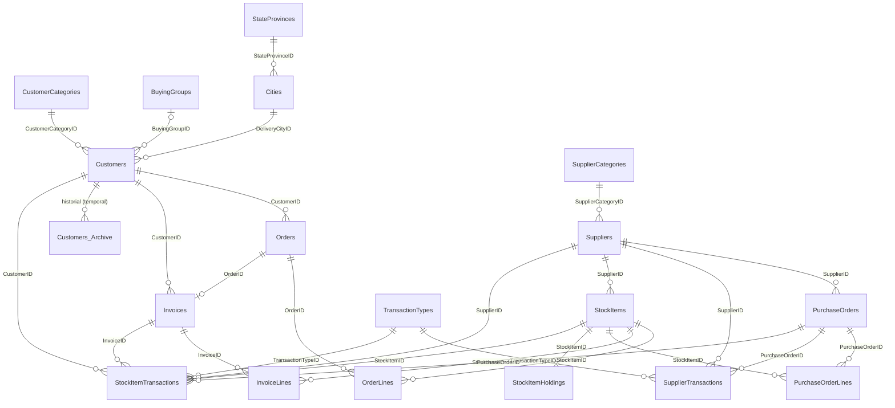

# ERD de la fuente (WideWorldImporters)

Relaciones obtenidas de `sys.foreign_keys` en SQL Server 2022 (16.0.4325) el 2026-11-15; se omiten las claves `LastEditedBy → Application.People`, presentes en todas las tablas, y las tablas no usadas. Conteos de filas reales.

## Tablas relevantes

| Esquema.Tabla | Filas | Tipo | Uso en la plataforma |
|---|---|---|---|
| Sales.Orders | 73,595 | Transaccional | Cabecera de pedido (fecha de dia, cliente) |
| Sales.OrderLines | 231,412 | Transaccional | **Grano de `FactSales`** |
| Sales.Invoices | 70,510 | Transaccional | Fecha de factura para rentabilidad |
| Sales.InvoiceLines | 228,265 | Transaccional | **Grano de `FactInvoiceProfit`** (`ExtendedPrice`, `LineProfit`) |
| Sales.Customers | 663 | Catalogo | `DimCustomer` (version vigente) |
| Sales.Customers_Archive | 51 | Historico temporal | Versiones SCD2 (50 con vigencia no vacia) |
| Sales.CustomerCategories / BuyingGroups | 8 / 2 | Catalogo | Atributos de cliente |
| Warehouse.StockItems | 227 | Catalogo | `DimProduct` |
| Warehouse.StockItemHoldings | 227 | Snapshot | `FactInventorySnapshot` (31-may-2016) |
| Warehouse.StockItemTransactions | 236,667 | Transaccional | `FactStockMovement` |
| Purchasing.Suppliers / SupplierCategories | 13 / 9 | Catalogo | `DimSupplier` |
| Purchasing.PurchaseOrders / PurchaseOrderLines | 2,074 / 8,367 | Transaccional | `FactPurchaseLine` (8,358 lineas recibidas) |
| Purchasing.SupplierTransactions | 2,438 | Transaccional | Factura de proveedor para fechar y conciliar compras |
| Application.Cities / StateProvinces | 37,940 / 53 | Catalogo | `DimGeography` (ciudad, estado, region de ventas) |
| Application.People | 1,111 | Catalogo | Auditoria (`LastEditedBy`); datos personales no expuestos |
| Application.TransactionTypes | 13 | Catalogo | Tipo de movimiento (10 = Stock Issue, 11 = Stock Receipt, 12 = Stocktake adjustment) |

## Claves y columnas de auditoria

- **Claves naturales:** `<Entidad>ID` (entero) en todas las tablas; se conservan en el DW para trazabilidad.
- **Auditoria de la fuente:** `LastEditedBy` y `LastEditedWhen` en las tablas operativas; las tablas temporales (`Customers`, `StockItems`, etc.) tienen `ValidFrom`/`ValidTo`. Estas columnas serian la base de un watermark incremental (pendiente).
- **Duplicados:** las claves primarias impiden duplicados en la fuente; la limpieza de catalogos deduplica por el primer campo `*ID`.

El diccionario de columnas del DW esta en [DICCIONARIO_DATOS.md](DICCIONARIO_DATOS.md). El perfilado columna a columna de la fuente aun no tiene reporte propio.
